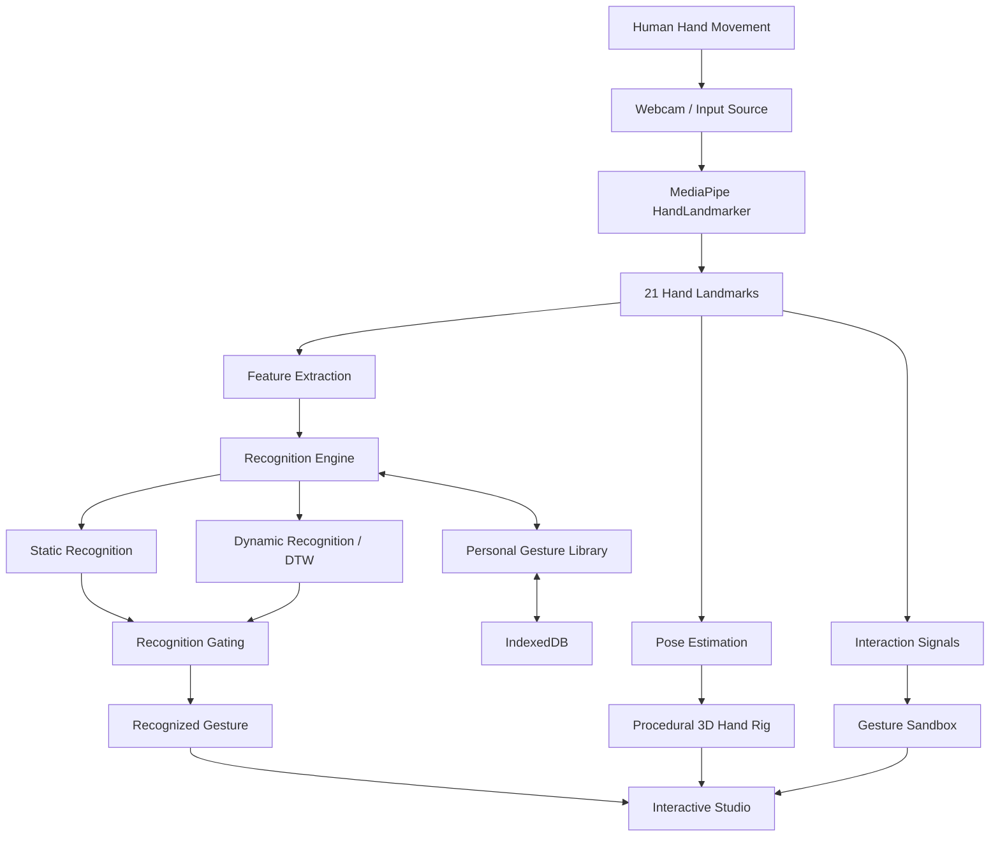
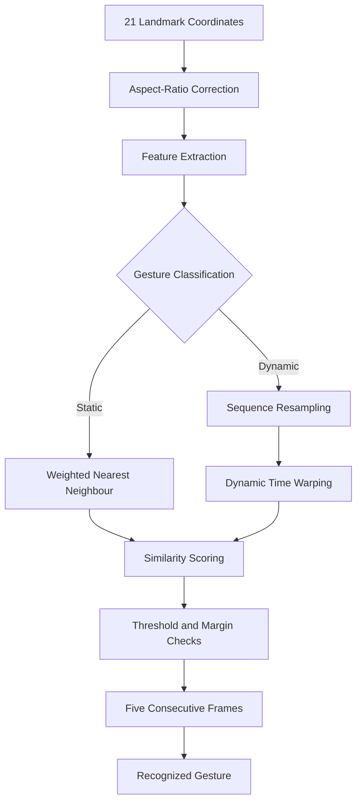

# NEUROHAND — YOUR HAND. YOUR LANGUAGE.

  

  <strong>A Premium 3D Gesture Learning & Recognition Studio</strong>
   
  Redefining how humans interact with intelligent environments.
    
  
  
  
  
  

---

## THE NEXT INTERFACE IS HUMAN.

What if your hand could become your own programmable interface?

**NEUROHAND** is a premium 3D Gesture Learning & Recognition Studio exploring a new approach to Human-Computer Interaction (HCI).

Instead of relying exclusively on predefined commands, NEUROHAND allows users to capture their own hand movements, create custom gestures, assign meaning to them, and teach a recognition system to understand their personal gesture vocabulary.

By combining real-time computer vision, procedural 3D modeling, hand kinematics, mathematical feature extraction, and gesture recognition algorithms, NEUROHAND transforms natural human movement into an interactive language.

This is not simply hand tracking.

It is an exploration of how humans can communicate with intelligent systems through natural movement.

## PROJECT DEMONSTRATION

  
   
  <strong>▶ WATCH NEUROHAND IN ACTION</strong>
   
  Full demonstration of the interactive studio, real-time tracking, gesture learning, recognition, and 3D interaction.

---

## THE EXPERIENCE

### 01 — Cinematic Introduction

A cinematic product introduction establishes the visual identity of NEUROHAND.

A graphite mechanical hand emerges from darkness through controlled studio lighting, camera choreography, and individual finger articulation.

The cinematic hand transitions into the live procedural 3D hand rig, creating a continuous experience from introduction to interaction.

### 02 — Real-Time Computer Vision

Powered by MediaPipe Tasks Vision, NEUROHAND tracks 21 hand landmarks and translates spatial relationships into meaningful articulation data.

Key capabilities:

- Real-time webcam tracking.
- Two-hand detection.
- Joint-angle estimation.
- Finger abduction and thumb opposition.
- Palm orientation and wrist rotation.
- Tracking confidence and inference latency.
- Exponential smoothing and tracking-loss handling.
- Automatic selection of the most confident detected hand.

### 03 — Procedural 3D Articulation

A fully procedural articulated hand built with Three.js.

The model contains five independently articulated digits, hierarchical joint structures, wrist orientation controls, and detailed mechanical geometry.

The visual construction includes:

- MCP, PIP, and DIP joint articulation.
- Thumb opposition and independent movement.
- Wrist pitch, yaw, and roll.
- Tapered phalanges.
- Machined mechanical joint rings.
- Thenar and hypothenar anatomical pads.
- Metacarpal ridges and dorsal volume.
- Graphite physically based materials.
- Runtime-generated studio environment.

The result is a 3D hand that responds to the user's actual movements.

### 04 — Capture. Name. Teach.

The signature feature of NEUROHAND is its personalized gesture-learning workflow.

Users can:

1. Perform a natural hand gesture.
2. Capture the movement.
3. Validate the recording.
4. Assign a name and description.
5. Save it to their personal gesture library.
6. Test the gesture through live recognition.

The recording engine distinguishes between static poses and dynamic movements, evaluates recording quality, and rejects unusable captures with specific feedback.

Each gesture stores its landmark sequences, normalized features, palm orientation, sample count, duration, creation date, and quality score.

Additional recordings under an existing gesture name can improve recognition robustness.

### 05 — Gesture Recognition Engine

NEUROHAND uses mathematical instance-based recognition rather than hardcoded gesture labels.

**Static Gesture Recognition**

- Weighted nearest-neighbor matching.
- A 20-dimensional feature vector.
- Adaptive tolerance based on intra-class variation.
- Soft-min aggregation of the three closest samples.
- Exponential similarity scoring.

**Dynamic Gesture Recognition**

Dynamic movements are represented as sequences and compared using:

- Fixed-length sequence resampling.
- Dynamic Time Warping (DTW).
- Sakoe–Chiba alignment constraints.
- Temporal matching across different movement speeds.

**Recognition Stability**

The recognition engine applies similarity thresholds, runner-up margin comparison, and five-frame stability gating before reporting a gesture.

Static recognition is damped during active movement to reduce false positives.

### 06 — Personal Gesture Library

A dedicated environment for managing custom gestures.

- Gesture search and filtering.
- Sorting by newest, name, or sample count.
- Static and dynamic categories.
- Real skeleton thumbnails generated from recorded poses.
- Sample counts and quality indicators.
- Test, rename, and delete operations.
- Persistent local storage using IndexedDB.

Four built-in example gestures are generated through the same feature extraction and recognition pipeline.

### 07 — Gesture-Controlled 3D Sandbox

An additional interactive environment demonstrates how hand movements can become virtual controls.

| Natural movement | Virtual interaction |
|---|---|
| Pinch | Grab an object |
| Move hand | Carry an object |
| Wrist roll | Rotate an object |
| Open palm | Release an object |
| Make a fist | Trigger a pulse |

Five metallic objects occupy a dedicated 3D studio environment, with a pinch-following cursor and visual interaction feedback.

---

## ENGINEERING ARCHITECTURE

NEUROHAND is designed around separated computational layers for perception, mathematical processing, recognition, 3D articulation, storage, and interface presentation.

### System Overview

### Recognition Pipeline

### Engineering Principles

**Separation of Concerns**

Tracking, mathematical processing, recognition, storage, rendering, and interface state are separated into dedicated architectural layers.

**High-Frequency Data Channels**

Landmarks, pose, features, interaction signals, and recognition results travel through dedicated channels rather than triggering continuous React component updates.

Interface-level values are published at approximately 9 Hz, reducing unnecessary rendering overhead while the camera pipeline operates at a higher frequency.

**Procedural Generation**

The articulated hand is constructed programmatically, avoiding dependency on an externally loaded hand model.

**Persistent Local Data**

Gesture recordings and preferences are stored locally in the browser, without requiring a remote account or backend service.

---

## TECHNOLOGY STACK

| Technology | Role |
|---|---|
| TypeScript | Application logic and type safety |
| React | Interactive studio interface |
| Three.js | 3D rendering and articulation |
| MediaPipe Tasks Vision | Real-time hand tracking |
| WebAssembly | Local vision runtime |
| IndexedDB | Persistent gesture storage |
| LocalStorage | Application preferences |
| Web Audio API | Cinematic audio |
| Playwright | Browser-level verification |

---

## PRIVACY-FIRST ARCHITECTURE

NEUROHAND follows a local-first design philosophy.

**No backend. No login. No cloud.**

- Webcam frames are processed locally.
- MediaPipe model and WASM assets are served by the application itself.
- Captured gestures are stored in browser IndexedDB.
- No external AI API is required for recognition.
- Camera footage is not uploaded to a remote server.

The camera requires explicit browser permission and a secure context such as localhost or HTTPS.

---

## VERIFICATION & ENGINEERING VALIDATION

The implementation includes a dedicated verification suite covering mathematical correctness, recognition behaviour, persistence, and browser-level workflows.

| Verification | Coverage |
|---|---|
| Core self-test | 31 assertions |
| Gesture workflow | Capture, save, learn, test, rename, reload, delete |
| Camera verification | Camera permission, model loading, inference |
| Responsive verification | 1280, 1024, and 430 px |
| Introduction verification | Intro transition and sandbox rendering |

Core mathematical validation includes:

- Kinematic calculations.
- Feature extraction.
- Distance and position invariance.
- Scale and rotation invariance.
- Flexion conventions.
- DTW alignment.
- Recognition ranking.
- Similarity thresholds.
- Static and dynamic recognition round trips.

---

## TECHNICAL TRANSPARENCY

NEUROHAND is an experimental personal gesture-learning system, not a general-purpose neural gesture classifier.

The simulated source is explicitly labelled. It drives the 3D hand through the same kinematic model used to generate the built-in examples and exercises the same recognition pipeline, but does not validate real webcam tracking.

Recognition thresholds are tuned and adaptive rather than trained through a neural network.

When two hands are detected, only the most confident hand drives the model.

Performance depends on browser capabilities, hardware acceleration, and the MediaPipe WASM execution environment.

These limitations are part of the engineering scope and are intentionally documented.

---

## PART OF THE SE7ENX / NEXORA ECOSYSTEM

NEUROHAND is developed as part of the broader **SE7ENX / NEXORA** vision: exploring intelligent interaction between people, digital systems, and physical environments.

The long-term direction is to extend gesture-based interaction beyond a standalone visual experience.

Potential integration areas include:

- Smart building interfaces.
- KNX automation.
- Home Assistant.
- Robotics and physical device control.
- Assistive interaction systems.
- Voice-assisted gesture commands.
- Multimodal human-machine interfaces.

The connection between NEUROHAND and NEXORA represents a broader engineering direction: making intelligent environments more natural to interact with.

*These integrations are future development directions, not currently claimed features.*

---

## THE VISION

The next generation of interfaces should not be limited to traditional input devices or predefined commands.

Natural movement, personal gestures, computer vision, and intelligent environments offer another way to interact with technology.

NEUROHAND is a step toward exploring that possibility.

Your hand is not just an input device.

**It can become your language.**

---

  <strong>NEUROHAND</strong>
   
  YOUR HAND. YOUR LANGUAGE.
    
  CAPTURE IT. TEACH IT. CONTROL IT.
    
  <a href="https://www.youtube.com/watch?v=6DZNtQNQqWQ">
    WATCH THE PROJECT DEMONSTRATION
  </a>
    
  AN ENGINEERING PROJECT WITHIN THE SE7ENX / NEXORA ECOSYSTEM.

