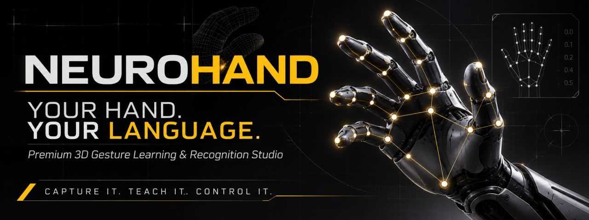
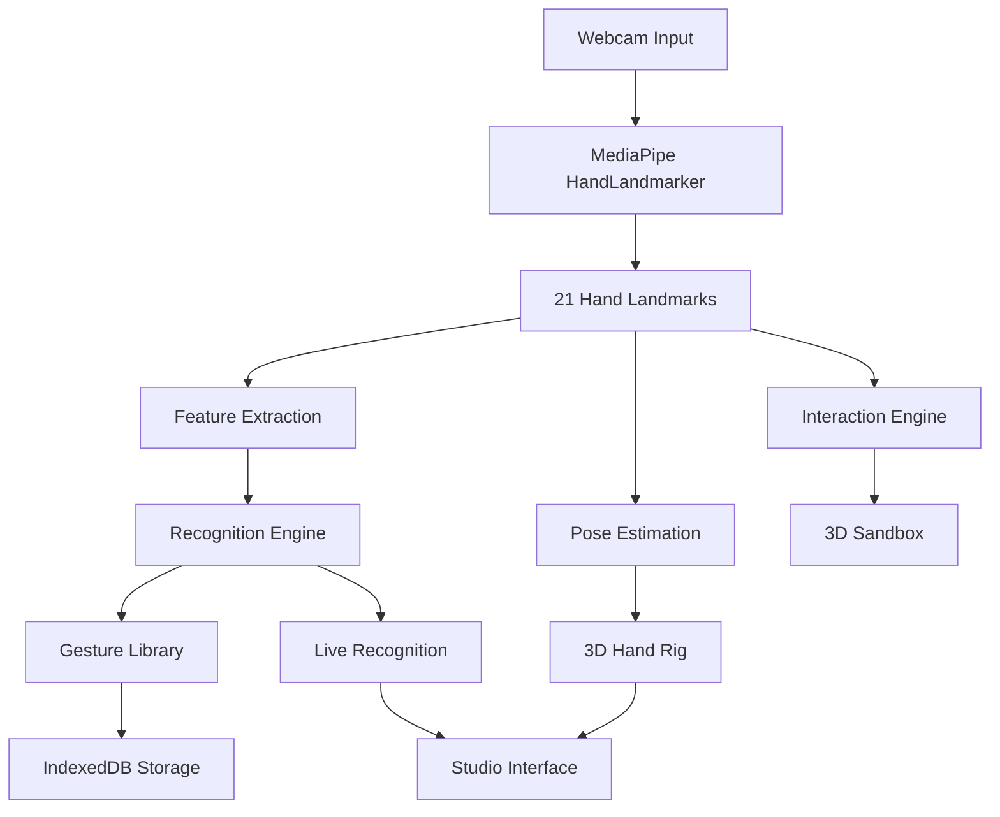
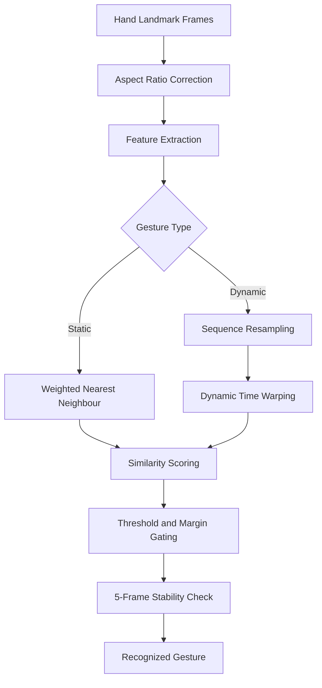

# NEUROHAND — YOUR HAND. YOUR LANGUAGE.

<p align="center">
  
</p>

<p align="center">
  <strong>A Premium 3D Gesture Learning & Recognition Studio</strong>
  <br />
  Turn natural hand movements into a programmable language.
  <br /><br />
  <a href="https://www.youtube.com/watch?v=6DZNtQNQqWQ">
    
  </a>
  
  
  
  
</p>

---

## The Next Interface Is Human.

What if your hand could become your own programmable interface?

**NEUROHAND** explores a different approach to Human-Computer Interaction (HCI), where users are not limited to predefined commands. Instead, they can capture their own hand gestures, give them meaning, teach the system, and have those gestures recognized in real time.

Built around computer vision, procedural 3D modeling, hand kinematics, and instance-based recognition algorithms, NEUROHAND transforms natural movements into a personal gesture vocabulary.

This is more than hand tracking.

It is an interactive environment where human movement becomes an interface.

## Watch the Project

<p align="center">
  <a href="https://www.youtube.com/watch?v=6DZNtQNQqWQ">
    
  </a>
  <br />
  <strong>▶ Watch NEUROHAND in Action</strong>
  <br />
  <a href="https://www.youtube.com/watch?v=6DZNtQNQqWQ">Full Project Demonstration on YouTube</a>
</p>

## Visual Experience

The application combines a cinematic introduction with an interactive technical studio.

<p align="center">
  
  <br />
  <em>Cinematic introduction and transition into the studio.</em>
</p>

<p align="center">
  
  <br />
  <em>Real-time computer vision and 3D hand articulation.</em>
</p>

<p align="center">
  
  <br />
  <em>Capture, name, save, and teach custom gestures.</em>
</p>

<p align="center">
  
  <br />
  <em>Live gesture recognition and matching.</em>
</p>

<p align="center">
  
  <br />
  <em>Interact with a virtual environment using natural hand movements.</em>
</p>

## Core Features

### 01. Real-Time Computer Vision

Powered by MediaPipe Tasks Vision and HandLandmarker.

- Detection of 21 hand landmarks.
- VIDEO-mode inference.
- Support for two detected hands.
- Real-time joint-angle extraction.
- Finger abduction and thumb opposition estimation.
- Palm orientation and wrist rotation.
- Exponential smoothing for stable movement.
- Tracking confidence, inference latency, and FPS monitoring.
- Automatic selection of the most confident hand when two hands are visible.

The computer vision runtime and model are hosted locally within the application.

### 02. Procedural 3D Articulated Hand

A fully procedural hand model built with Three.js.

No external 3D hand model is required.

Features include:

- Five articulated digits.
- Anatomical joint hierarchy.
- MCP, PIP, and DIP articulation.
- Thumb opposition and independent articulation.
- Wrist pitch, yaw, and roll.
- Tapered phalanges and mechanical joint details.
- Graphite materials and physically based rendering.
- Dynamic lighting and studio environment.

The 3D hand responds to the movements detected by the webcam.

### 03. Capture Your Own Gestures

The signature feature of NEUROHAND.

Users can create their own gesture vocabulary:

1. Perform a hand gesture.
2. Capture the movement.
3. Validate the recording.
4. Give the gesture a name and description.
5. Save it to the personal gesture library.
6. Test it in real time.

The recorder distinguishes between static poses and dynamic movements.

Unusable recordings are rejected with specific validation feedback.

Each saved gesture includes:

- Gesture name and description.
- Raw landmark sequences.
- Normalized joint-angle features.
- Palm orientation.
- Static or dynamic classification.
- Number of samples.
- Recording duration.
- Creation timestamp.
- Quality score.

Additional recordings under an existing gesture name improve its recognition robustness.

### 04. Real Gesture Recognition Algorithms

NEUROHAND does not rely on hardcoded gesture labels or a predefined neural classifier.

It uses an instance-based recognition pipeline.

**Static Gesture Recognition**

- Weighted nearest-neighbor matching.
- A 20-dimensional feature vector.
- Adaptive tolerance based on intra-class variation.
- Soft-min aggregation of the three closest samples.
- Similarity scoring using an exponential distance function.

**Dynamic Gesture Recognition**

Dynamic gestures are represented as time sequences.

The recognition pipeline uses:

- Fixed-length sequence resampling.
- Dynamic Time Warping (DTW).
- Sakoe–Chiba alignment constraints.
- Temporal matching for movements performed at different speeds.

**Recognition Stability**

A gesture is only accepted when:

- Its similarity exceeds the configured threshold.
- It sufficiently outperforms the runner-up.
- The result remains stable for five consecutive frames.

Static recognition is also damped during active hand movement to reduce false positives.

### 05. Personal Gesture Library

A dedicated workspace for managing recorded gestures.

- Search and filtering.
- Sort by newest, name, or sample count.
- Static and dynamic gesture categories.
- Real skeleton thumbnails generated from captured poses.
- Quality indicators and sample counts.
- Test, rename, and delete actions.
- Persistent storage using IndexedDB.
- In-memory fallback when IndexedDB is unavailable.

Four built-in examples are generated through the same recognition pipeline and can be deleted.

### 06. Gesture-Controlled 3D Sandbox

An additional interactive environment where hand movements become virtual controls.

| Gesture / Movement | Interaction |
|---|---|
| Pinch | Grab an object |
| Move hand | Carry an object |
| Wrist roll | Rotate an object |
| Open palm | Release an object |
| Make a fist | Trigger a pulse |

The environment contains five metallic objects in a dark 3D studio.

A visual cursor follows the pinch point, while a HUD communicates the interaction state.

### 07. Premium Interface & Experience

The application is designed as a complete interactive studio.

**Left Panel**
- Live camera preview.
- Hand skeleton overlay.
- Articulation readouts.
- Tracking and calibration information.

**Central Workspace**
- Interactive 3D articulated hand.
- Four camera presets.
- Blueprint measurements.
- Grid and axis gizmo.
- Floating controls.

**Right Panel**
- Gesture library.
- Selected gesture information.
- Recognition and sample data.

**Performance Monitor**
- Source status.
- FPS.
- Detection confidence.
- Inference latency.
- Recording status.
- Calibration state.
- Gesture count.

Keyboard shortcuts:

| Shortcut | Action |
|---|---|
| `1–4` | Camera views |
| `R` | Reset camera |
| `G` | Toggle grid |
| `A` | Toggle annotations |
| `C` | Capture gesture |
| `T` | Test selected gesture |
| `M` | Switch interaction mode |
| `H` | Help |
| `Esc` | Close / skip intro |

---

## Technical Architecture

NEUROHAND separates computer vision, mathematical processing, recognition, rendering, and interface state.



### Recognition Pipeline



### Project Structure

```text
NEUROHAND/
│
├── public/
│   ├── models/
│   │   └── hand_landmarker.task
│   │
│   ├── mediapipe/
│   │   └── wasm/
│   │
│   └── brand/
│       └── key-visual.jpg
│
├── assets/
│   └── gifs/
│       ├── 01-cinematic-intro.gif
│       ├── 02-live-tracking.gif
│       ├── 03-gesture-learning.gif
│       ├── 04-gesture-recognition.gif
│       └── 05-gesture-sandbox.gif
│
├── src/
│   ├── core/
│   │   ├── types.ts
│   │   ├── math.ts
│   │   ├── features.ts
│   │   ├── pose.ts
│   │   ├── handModel.ts
│   │   ├── recognition.ts
│   │   ├── interaction.ts
│   │   ├── storage.ts
│   │   └── examples.ts
│   │
│   ├── tracking/
│   │   ├── engine.ts
│   │   └── recorder.ts
│   │
│   ├── three/
│   │   ├── handRig.ts
│   │   ├── StudioScene.tsx
│   │   ├── ObjectScene.tsx
│   │   └── env.ts
│   │
│   ├── state/
│   │   ├── store.ts
│   │   └── channels.ts
│   │
│   ├── studio/
│   ├── screens/
│   └── ui/
│
├── scripts/
│   ├── selftest
│   ├── flow.mjs
│   ├── camera-test.mjs
│   ├── responsive.mjs
│   └── intro-flow.mjs
│
├── neo01.jpg
├── package.json
└── README.md
```

## Technology Stack

| Technology | Purpose |
|---|---|
| TypeScript | Application logic and type safety |
| React | Interface and component architecture |
| Three.js | 3D rendering |
| MediaPipe Tasks Vision | Hand landmark detection |
| WebAssembly | Local computer vision runtime |
| IndexedDB | Persistent gesture storage |
| LocalStorage | User preferences |
| Web Audio API | Cinematic sound design |
| Playwright | Browser-level verification |

## Getting Started

### Requirements

- Node.js and npm.
- A modern browser with WebGL support.
- Webcam access for real tracking.
- A secure browser context: `localhost` or HTTPS.

### Installation

Clone the repository:

```bash
git clone YOUR_REPOSITORY_URL
cd NEUROHAND
```

Install dependencies:

```bash
npm install
```

Start the development server:

```bash
npm run dev
```

Open:

```text
http://localhost:5173
```

### Production Build

```bash
npm run build
```

The production bundle is generated inside:

```text
dist/
```

### Run Self-Tests

```bash
npm run selftest
```

The headless test suite executes 31 assertions covering the mathematical and recognition pipeline.

## Verification & Testing

NEUROHAND includes dedicated verification workflows.

| Test | What it verifies |
|---|---|
| `npm run selftest` | 31 assertions across the core algorithms |
| `flow.mjs` | Capture, save, learn, test, rename, reload and delete |
| `camera-test.mjs` | Webcam access, model loading and inference |
| `responsive.mjs` | Layout at 1280, 1024 and 430 px |
| `intro-flow.mjs` | Cinematic introduction and sandbox rendering |

The mathematical tests cover:

- Kinematic calculations.
- Feature extraction.
- Distance and position invariance.
- Scale and rotation invariance.
- Flexion conventions.
- DTW alignment.
- Recognition ranking.
- Threshold behaviour.
- Static and dynamic recognition round trips.

## Privacy-First by Design

Privacy is a core architectural decision.

NEUROHAND is designed to work without a backend, user accounts, or cloud processing.

- Webcam processing runs locally.
- MediaPipe WASM and model files are served by the application.
- Captured gesture data is stored locally in IndexedDB.
- No external AI API is required for gesture recognition.
- No camera feed is uploaded to a remote server.

**Your hand movements stay on your machine.**

## Honest Technical Limitations

NEUROHAND is an experimental personal gesture-learning studio, not a general-purpose neural gesture classifier.

A few important distinctions:

- The simulated source is clearly labelled and is not real camera tracking.
- Simulated gestures use the same recognition pipeline but do not validate webcam detection.
- Recognition thresholds are tuned and adaptive, not learned through neural network training.
- The instance-based approach is designed for personal gesture vocabularies rather than unrestricted gesture classification.
- Only the most confident detected hand drives the model when two hands are visible.
- Performance depends on browser capabilities and available hardware acceleration.

Repeated captures can improve robustness, but recognition quality still depends on recording consistency.

## Design Philosophy

Three principles guide NEUROHAND:

**1. Personalization**

People should be able to create their own gesture vocabulary rather than being restricted to predefined commands.

**2. Local Intelligence**

Interactive computer vision should be possible without sending personal camera data to external servers.

**3. Human-Centred Interaction**

Technology should adapt to natural human movements, not force people to adapt to complicated interfaces.

## Future Directions

Potential areas for further development:

- Gesture-to-voice commands.
- Multilingual gesture naming and voice feedback.
- Integration with smart building systems.
- KNX and Home Assistant control.
- Robotics and physical device interaction.
- Multi-user gesture profiles.
- Expanded gesture vocabulary and recognition benchmarking.
- Accessibility-focused interaction experiences.

These are future development directions, not claims about currently implemented features.

## The Vision

NEUROHAND is an exploration of how computer vision and human movement can redefine interaction with digital and physical environments.

From controlling virtual objects to potentially interacting with smart buildings, assistive technologies, and robotics, the possibilities extend far beyond a traditional computer interface.

The hand is not just an input device.

It can become a language.

---

<p align="center">
  <strong>NEUROHAND</strong>
  <br />
  YOUR HAND. YOUR LANGUAGE.
  <br /><br />
  CAPTURE IT. TEACH IT. CONTROL IT.
  <br /><br />
  <a href="https://www.youtube.com/watch?v=6DZNtQNQqWQ">WATCH THE PROJECT DEMO</a>
</p>
